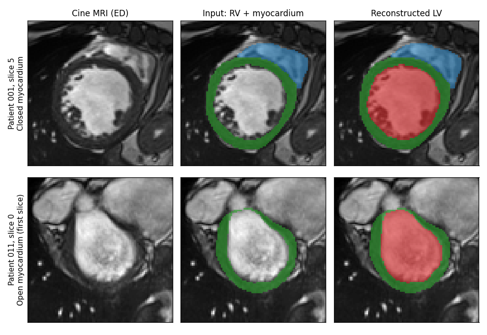

# acdc-cardiac-diagnosis

Classification of five cardiac diagnoses (NOR, MINF, DCM, HCM, RV) from cine-MRI segmentations of the ACDC dataset, done for the IMA205 Kaggle in-class challenge (Télécom Paris, 2025).



*LV reconstruction from the RV and myocardium labels. Top: closed myocardium. Bottom: open myocardium, closed by a dilation first.*

## Results

LV reconstruction matches the ground truth exactly for 99% of patients at ED and 100% at ES (100 training patients).

| Model | 5-fold CV (n=90) | Kaggle private leaderboard |
|---|---|---|
| Random forest | 0.90 | 0.88 |
| MLP | 0.92 | 0.88 |
| SVM | 0.93 | 0.77 |
| XGBoost | 0.92 | 0.77 |
| Soft voting (RF + MLP + XGBoost) | 0.91 | 0.77 |

The best submission ranked in the top 10% of the challenge.

## Quick start

```bash
pip install -e .
python scripts/evaluate_segmentation.py --data-dir data
python scripts/train.py --data-dir data --model rf --submission submission.csv
```

The data comes from the [ACDC challenge](https://www.creatis.insa-lyon.fr/Challenge/acdc/) and goes in `data/` (`Train/`, `Test/`, `metaDataTrain.csv`, `metaDataTest.csv`).

## Method

- The 50 test patients have no LV label. The LV is recovered without learning: fill the outer myocardium contour and keep the largest connected component.
- When the myocardium ring is open, it is dilated with a 3x3 cross before filling.
- 42 biomarkers per patient: volumes, ejection fractions, myocardial mass, volume ratios, volumes indexed to body surface area, wall thickness and shape.
- Standardisation, PCA (95% of the variance), random forest feature selection, then grid search with 5-fold stratified CV.

Details are in [docs/report.pdf](docs/report.pdf) and [notebooks/01_cardiac_diagnosis.ipynb](notebooks/01_cardiac_diagnosis.ipynb).

## Structure

```
src/acdc_diagnosis/  data loading, LV reconstruction, features, classification
scripts/             evaluate_segmentation.py, train.py
notebooks/           original exploration and submitted run
docs/                course report
figures/             README figures
```

## References

1. O. Bernard et al., "Deep Learning Techniques for Automatic MRI Cardiac Multi-Structures Segmentation and Diagnosis: Is the Problem Solved?", IEEE TMI, 2018.
2. F. Isensee et al., "Automatic Cardiac Disease Assessment on cine-MRI via Time-Series Segmentation and Domain Specific Features", STACOM 2017.
3. M. Khened, V. Alex, G. Krishnamurthi, "Densely Connected Fully Convolutional Network for Short-Axis Cardiac Cine MR Image Segmentation and Heart Diagnosis Using Random Forest", STACOM 2017.

## Author

Quentin Revillon, Télécom Paris. IMA205 course by Pietro Gori and Loïc Le Folgoc.
