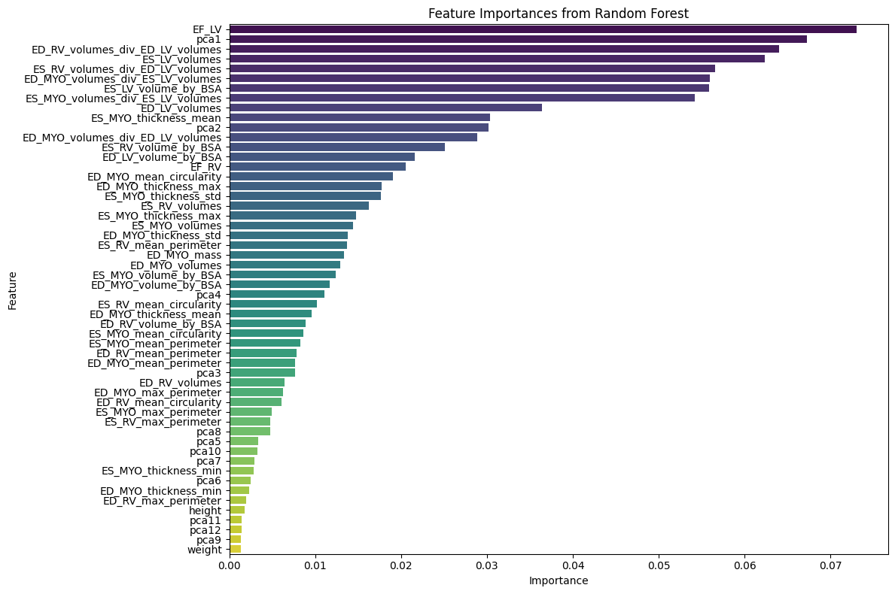

# acdc-cardiac-diagnosis — cardiac pathology classification on ACDC

**acdc-cardiac-diagnosis** predicts one of five cardiac diagnoses (NOR, MINF, DCM, HCM, RV) from
cine-MRI segmentations of the ACDC dataset. It first reconstructs the missing left ventricle (LV) label
with morphological operations, then computes 42 cardiac biomarkers and classifies them with
random forest, MLP, SVM and XGBoost models.


*LV reconstruction from the RV and myocardium labels. Top: closed myocardium, filled directly.
Bottom: open myocardium, closed by a one-pixel dilation first. Both slices match the ground truth exactly.*

## Overview

- **Task**: Kaggle in-class challenge of the IMA205 course (Télécom Paris, 2025). 100 labelled training
  patients with RV, myocardium and LV labels; 50 test patients whose LV label is missing.
- **Segmentation**: the LV is the cavity enclosed by the myocardium. It is recovered without learning,
  by contour filling and connected components, with a dilation fallback for open myocardium rings.
- **Diagnosis**: biomarkers from the literature (volumes, ejection fractions, ratios, volumes indexed to
  body surface area, wall thickness, shape), standardisation, PCA, random forest feature selection,
  then grid-searched classifiers.

Full description: [docs/report.pdf](docs/report.pdf).

## Results

**LV reconstruction** (LV removed from the 100 training patients, then reconstructed; a patient counts
as a success when all labels match the ground truth exactly):

| Method | ED (n=100) | ES (n=100) |
|---|---|---|
| Contour filling only | 98% | 95% |
| + dilation fallback (final) | 99% | 100% |

The only remaining failure is the first slice of patient 029, where the myocardium is too open.

**Diagnosis** (accuracy, 5 classes):

| Model | 5-fold CV (n=90) | Kaggle private leaderboard (n=50) |
|---|---|---|
| Random forest | 0.90 | **0.88** |
| MLP | 0.92 | **0.88** |
| SVM | 0.93 | 0.77 |
| XGBoost | 0.92 | 0.77 |
| Soft voting (RF + MLP + XGBoost) | 0.91 | 0.77 |

The best submission ranked in the top 10% of the challenge. Cross-validation scores come from
[notebooks/01_cardiac_diagnosis.ipynb](notebooks/01_cardiac_diagnosis.ipynb); feature selection was fitted
on the same 90 patients, so they are optimistic compared with the leaderboard.



*Random forest importance of the 42 biomarkers and of the principal components (pca1, pca2, ...).
The LV ejection fraction and the first principal component rank first.*

## Installation

```bash
conda create -n acdc python=3.12 -y && conda activate acdc
pip install -e .
```

## Quick start

Place the challenge data in `data/` (see [Data](#data)), then:

```bash
# LV reconstruction on the training set, compared with the ground truth
python scripts/evaluate_segmentation.py --data-dir data

# Feature extraction, tuning, cross-validation and hold-out evaluation; writes the test predictions
python scripts/train.py --data-dir data --model rf --submission submission.csv
```

`--model` is one of `rf`, `mlp`, `svm`, `xgb`, `voting`; `--seed` (default 0) fixes the 90/10 split,
the cross-validation folds and the models. Scores vary with the seed because the dataset is small.

| Output | Content |
|---|---|
| stdout | selected features, 5-fold CV and hold-out accuracy with per-class metrics |
| `submission.csv` | `Id,Category` for the 50 test patients (Kaggle format) |

## Repository structure

- `src/acdc_diagnosis/data.py`: load segmentations, voxel volumes and patient metadata.
- `src/acdc_diagnosis/segmentation.py`: LV reconstruction from the myocardium mask.
- `src/acdc_diagnosis/features.py`: the 42 cardiac biomarkers.
- `src/acdc_diagnosis/classification.py`: preprocessing, feature selection, hyperparameter grids, voting ensemble.
- `scripts/evaluate_segmentation.py`, `scripts/train.py`: entry points.
- `notebooks/01_cardiac_diagnosis.ipynb`: original exploration and submitted run, with all outputs
  (expects the data in `Dataset/` next to the notebook).
- `docs/report.pdf`: course report.

## Method

**LV reconstruction** (per 2D slice). The outer contour of the myocardium is filled with OpenCV and the
pixels that are not myocardium form the LV candidate; the largest 8-connected component is kept. When
the ring is open, nothing is enclosed: the myocardium is dilated with a 3x3 cross, filled, the cavity is
dilated back with the same element, and the background pixels left between the LV and the myocardium are
added to the LV.

**Features.** For each phase (ED, ES): RV, myocardium and LV volumes; maximum and mean perimeter and mean
circularity of the RV and myocardium over the slices; minimum, mean, maximum and standard deviation of the
myocardial wall thickness. Across phases: LV and RV ejection fractions, myocardial mass, RV/LV and
myocardium/LV volume ratios, volumes indexed to body surface area (Mosteller), height and weight.

**Classification.** Standardisation, concatenation of the principal components explaining 95% of the
variance, selection of the features whose importance in a 10,000-tree random forest is above the mean
(14 to 20 features depending on the split), then grid search with 5-fold stratified cross-validation.
Hyperparameters selected in the submitted run:

| Model | Hyperparameters |
|---|---|
| Random forest | 200 trees, min_samples_leaf 1, min_samples_split 2 |
| MLP | 1 hidden layer of 50 neurons, Adam, L2 1e-4, learning rate 0.01 |
| SVM | linear kernel, C 10, gamma scale |
| XGBoost | 100 trees, max depth 3, learning rate 0.01, subsample 0.5, colsample_bytree 0.7 |

## Data

ACDC (Automated Cardiac Diagnosis Challenge, MICCAI 2017) [1], available from the
[Creatis challenge page](https://www.creatis.insa-lyon.fr/Challenge/acdc/). The challenge version used here
provides the ED and ES segmentations of 150 patients. Expected layout (not tracked by git):

```
data/
├── metaDataTrain.csv        # Id, Category, Height, Weight
├── metaDataTest.csv         # Id, Height, Weight
├── Train/001/001_ED_seg.nii # patients 001-100, labels 1 RV, 2 myocardium, 3 LV
└── Test/101/101_ED_seg.nii  # patients 101-150, labels 1 RV, 2 myocardium
```

Category labels: 0 NOR (normal), 1 MINF (previous myocardial infarction), 2 DCM (dilated cardiomyopathy),
3 HCM (hypertrophic cardiomyopathy), 4 RV (abnormal right ventricle).

## References

1. O. Bernard et al., "Deep Learning Techniques for Automatic MRI Cardiac Multi-Structures Segmentation and
   Diagnosis: Is the Problem Solved?", IEEE Transactions on Medical Imaging, 2018.
2. F. Isensee et al., "Automatic Cardiac Disease Assessment on cine-MRI via Time-Series Segmentation and
   Domain Specific Features", STACOM 2017.
3. M. Khened, V. Alex, G. Krishnamurthi, "Densely Connected Fully Convolutional Network for Short-Axis
   Cardiac Cine MR Image Segmentation and Heart Diagnosis Using Random Forest", STACOM 2017.
4. J. M. Wolterink, T. Leiner, M. A. Viergever, I. Išgum, "Automatic Segmentation and Disease
   Classification Using Cardiac Cine MR Images", STACOM 2017.

## Author

Quentin Revillon, Télécom Paris. IMA205 course by Pietro Gori and Loïc Le Folgoc.
